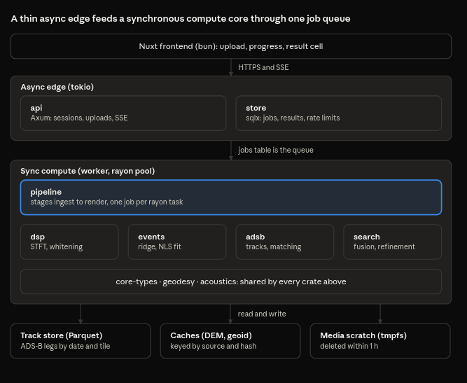

# SDD — Doppler Locatability Audit

Nov 4, 2026 · @zahir

## 1. Purpose and scope

This SDD says how the system in the [PRD](PRD.md) is built: architecture, methods, data design, API and operations. It folds the method specification and the database design into one document, so the implementing agent reads one source. Requirement IDs (FR, NFR, G) refer to the PRD and appear in the traceability table in section 13.

**Detail level.** v0 and v1 are specified to implementation level. v2 (accounts) and v3 (experiments) are outlined only.

**Conventions.** SI units. WGS84 coordinates. Two clocks: the audio clock `t_a` (seconds from file start) and UTC `t_u`, related by the unknown recording start `s`, so `t_u = s + t_a`. ADS-B times are UTC in milliseconds. All uncertainties are covariance matrices, never bare tolerances.

## 2. Architecture

A thin async edge accepts requests and owns the job queue, a synchronous compute core does all the signal processing, and files hold the large data. The picture shows which layer and store each crate belongs to.



The `api` crate never runs DSP and the worker never touches HTTP. The `sim` and `cli` crates link the same libraries and run offline.

## 3. Workspace layout

One Cargo workspace on stable Rust. Library crates are pure and synchronous, except `runtime`, which owns the tokio task machinery. Only `adsb`, `store` and `runtime` do I/O, and tokio appears only in `runtime`, `api` and `worker`.

| Crate | Responsibility | Typical dependencies | Requirements |
| --- | --- | --- | --- |
| `core-types` | Unit newtypes, time types, error types, run-manifest types, `JobCtx`, `Cancel`, `Clock` | serde, thiserror | all |
| `geodesy` | WGS84, ECEF and local ENU frames, geoid grid, DEM sampler trait | nalgebra | FR-DA-02 |
| `acoustics` | Atmosphere, light-time solver, emission-time Doppler model | none | FR-DM-03, FR-DA-03 |
| `dsp` | Resampling, Kaiser FIR design, STFT, noise whitening, ridge tracking | realfft, rayon | FR-IN-01, FR-DM-01 |
| `events` | Detection, per-event fit, direct estimator, covariance, quality score | nalgebra, an LM optimizer | FR-DM-01 to FR-DM-06 |
| `adsb` | Open-archive ingest, columnar track store (Parquet), interpolation, closest-approach | arrow, parquet, reqwest | FR-DA-01, FR-DA-04 |
| `search` | Hypotheses, join, likelihood fusion, refinement, calibration, verdict | rayon | FR-SL-01 to FR-SL-05 |
| `sim` | Scenario model, audio synthesis, error injection, CRLB, Monte Carlo | rand | FR-SIM-01 to FR-SIM-04 |
| `pipeline` | Orchestrates stages with progress callbacks, cancellation and budgets | the crates above | FR-OUT-01 to FR-OUT-04 |
| `store` | Relational repositories, migrations, blob store, retention sweeper | sqlx | FR-AC-04, FR-OP-02 |
| `runtime` | Task machinery shared by both binaries: `Scope`, cancel bridge, `JobOutcome`, `run_job`, claim loop, lease heartbeat (section 11.6) | tokio, tokio-util, store, pipeline | FR-OP-01 |
| `api` (bin) | Axum routes, SSE, rate limiting, bot challenge | axum, tower, runtime | FR-AC, FR-OP, FR-OUT |
| `worker` (bin) | Thin main that starts the runtime's worker loop on a CPU pool | runtime, rayon | FR-OP-01 |
| `cli` (bin) | Run the pipeline and simulator locally, emit manifests | clap | FR-OUT-04 |

**Dependency direction.** `core-types` ← `geodesy` ← `acoustics` ← `dsp` ← `events` ← `search` ← `pipeline` ← `runtime` ← `api`/`worker`. `cli` links `pipeline`, `sim` and the libraries. `sim` depends on `acoustics`, `geodesy` and `core-types` only, never on `events` or `search`, so tests cannot share a bug with the code they test.

**Rules.** `#![forbid(unsafe_code)]` everywhere, with no exceptions. Warnings fail CI. Every public function that implements a requirement cites its FR ID in a doc comment.

**3.1 Repository layout.** One repository, one lowercase `docs/` directory, and nothing outside the directories below. Crate directories are named exactly like their crates.

```text
doppler-locator/
├── LICENSE                  AGPL-3.0
├── README.md
├── Cargo.toml               workspace members, shared dependencies, lints
├── Cargo.lock
├── rust-toolchain.toml
├── clippy.toml
├── deny.toml                licence and advisory policy
├── .github/workflows/ci.yml
├── crates/
│   ├── core-types/          Hertz, Seconds, LatLon, JobCtx, Cancel, Clock
│   ├── geodesy/
│   ├── acoustics/
│   ├── sim/
│   ├── dsp/
│   ├── events/
│   ├── adsb/
│   ├── search/
│   ├── pipeline/
│   ├── store/
│   ├── runtime/             Scope, worker loop, JobOutcome
│   ├── api/                 binary
│   ├── worker/              binary
│   └── cli/                 binary
├── migrations/              sqlx, common SQL subset
├── .sqlx/                   offline query data
├── config/                  default.toml, region and limit profiles
├── scenarios/               simulator scenario files (JSON)
├── testdata/                fixtures under 1 MB each
├── web/                     Nuxt and bun frontend, specified in docs/ui_ux.md
├── deploy/                  Dockerfile, proxy and service configuration
├── docs/
│   ├── PRD.md
│   ├── SDD.md
│   ├── rust-working-norms.md
│   ├── ui_ux.md
│   ├── traceability.csv
│   ├── questions.md
│   ├── third_party.md
│   ├── assets/              architecture.png
│   ├── proposals/
│   └── ops/                 abuse response, backups, runbook
└── data/                    git-ignored: caches, Parquet tracks, run output
```

**Inside a crate.** Each crate has `Cargo.toml`, `src/lib.rs` (or `src/main.rs` for binaries) and `tests/`. Benchmarks live in `benches/` for `dsp` and `search`. The module sketch below is a starting point; the implementer may rename modules, but not move code across crate boundaries without a proposal.

| Crate | Main modules |
| --- | --- |
| `core-types` | `units`, `time` (two clocks), `ctx` (`JobCtx`, `Cancel`), `clock`, `ids` |
| `geodesy` | `ellipsoid`, `enu`, `dem`, `geoid` |
| `acoustics` | `doppler` (retarded time, closed form and root finder), `atmosphere`, `propagation` |
| `sim` | `scenario`, `synth`, `adsb_errors`, `montecarlo`, `crlb` |
| `dsp` | `resample`, `window`, `stft`, `whiten`, `ridge` (peak, Viterbi, Kalman) |
| `events` | `detect`, `fit` (track-then-fit, direct ML), `quality` |
| `adsb` | `source` (trait), `opensky`, `adsblol`, `tracks` (Parquet store), `legs`, `interpolate` |
| `search` | `likelihood`, `grid`, `join`, `refine`, `posterior`, `verdict`, `coarsen` |
| `pipeline` | `stages`, `manifest`, `report` |
| `store` | `jobs`, `results`, `limits`, `retention` |
| `runtime` | `scope`, `bridge`, `outcome`, `run_job`, `claim`, `sweeper`, `shutdown` |
| `api` | `routes`, `middleware` (limits, attestation), `dto`, `error`, `sse` |
| `worker` | `main` only |
| `cli` | `analyze`, `sim`, `ingest`, `eval` |

## 4. Signal and physics model

A propeller aircraft emits a harmonic tone with fundamental `f0` and integer harmonics. A listener hears it with a delay and a frequency shift that both depend on where the aircraft was when it emitted the sound, not where it is when the sound arrives.

**Light-time and Doppler.** For aircraft position `p(t_e)` at emission time `t_e`, observer position `x` and sound speed `c`:

$$
\begin{aligned}
t_r &= t_e + \frac{\lVert p(t_e) - x \rVert}{c}, \\
f_h(t_r) &= h\, f_0 \,\frac{c}{c + v_r(t_e)}, \\
v_r &= \frac{d}{dt_e}\lVert p(t_e) - x \rVert
\end{aligned}
$$

`v_r` is positive when the aircraft recedes and `h` is the harmonic number. The frequency heard at `t_r` is set by the radial velocity at `t_e`. Modelling it with the velocity at `t_r` and delaying the curve is wrong: the result is a different curve, not a shifted one.

**Straight, constant-speed pass.** Let `d` be the closest distance, `v` the speed, `t0e` the emission time of closest approach, `τ = t_e − t0e` and `u = t_r − t0e`. Substituting `‖p − x‖ = √(d² + v²τ²)` into the first equation and squaring gives a quadratic in `τ`. The root with `t_e ≤ t_r` (needs `v < c`) is:

$$
\begin{aligned}
\tau(u) &= \frac{c^2 u - \sqrt{c^2 v^2 u^2 + d^2 (c^2 - v^2)}}{c^2 - v^2}, \\
v_r &= \frac{v^2 \tau}{\sqrt{d^2 + v^2 \tau^2}}, \\
t_{0r} &= t_{0e} + \frac{d}{c}
\end{aligned}
$$

`t0r` is the closest approach as heard. Three readouts identify the parameters: the asymptotes `f0·c/(c−v)` before and `f0·c/(c+v)` after, the heard centre `t0r`, and the steepest slope `f0·v²/(c·d)` at closest approach. Speed comes from the size of the drop, distance from the steepness.

**Event parameters.** `θ = (f0, v, d, t0r)` plus per-harmonic amplitudes, and optionally a linear drift of `f0` to absorb RPM change.

**Real tracks.** The straight-line form is used only to detect and to seed fits. For matching against ADS-B, `p(t)` is the Hermite-interpolated track and `t_e` is solved from `t_r` by bracketed Newton iteration, which is well-posed because the aircraft is subsonic and `t_r` is monotone in `t_e`.

**Atmosphere.** Sound speed follows temperature (about 0.6 m/s per °C near 20 °C). Wind enters as the component along the propagation path, averaged along the path from public weather data. Without data, the model uses a standard atmosphere and flags the result. Both treatments are validated in the simulator (section 7) before the search relies on them.

**What one event gives.** One event with a matched flight fixes a curve of possible observer positions, each tied to a different recording start `s`. Two events at a known real time gap fix a point. One event plus a known time still fixes only a curve, unless the silence term or the land prior picks a position on it (section 6.5). A single straight pass is also mirror-symmetric: the observer can stand on either side of the track at the same distance d. Only a second event with different geometry, the silence term or the land prior breaks the tie; otherwise both mirror positions stay in the posterior and the verdict is at most Ambiguous. This is why FR-SL-02 refuses single events.

## 5. Measurement methods

Goal: turn audio into a list of events, each with `θ`, a covariance and a quality score, with no manual tracing. Numeric settings below are starting values; v0 tunes them on the simulator.

1. **Decode and front end** (FR-IN-01). Decode to mono PCM. Band-limit to about 20–1500 Hz, where propeller fundamentals and their first harmonics sit, and decimate with a polyphase FIR designed by the Kaiser window method (stopband at least 80 dB). Remove DC. The lower rate makes every later stage cheaper and allows longer analysis windows at the same time resolution.
2. **Spectrogram and whitening.** Kaiser-windowed STFT with 75% overlap. For surveying, a fixed window near 1 s. For measuring an event, the window is chosen from the expected chirp rate: smearing stays under one bin when `T ≈ 1/√(max |df/dt|)`, clamped to 0.25–2 s, with zero-padding and parabolic peak interpolation for sub-bin frequency. Noise is whitened per frequency bin with a running median and MAD over time, giving a z-map in which noise has roughly unit scale. A second pass masks detected events before re-estimating the noise.
3. **Detection** (FR-DM-01). A generalized likelihood ratio detector. Templates are emission-time Doppler curves with a harmonic comb, over a grid of speed (about 40–180 m/s) and closest distance (about 200 m–12 km), slid over time and base frequency. The statistic is the normalized correlation of the template with the z-map. Both the approach half and the recede half must each exceed a threshold, which rejects steady hum and clicks. The threshold is set by a Neyman–Pearson rule at a configured false-alarm rate per hour, with the null estimated empirically from templates evaluated on time-reversed and frequency-shifted maps.
4. **Ridge tracking ladder.** Level 1: per-frame peak inside the template corridor. Level 2: Viterbi path through the z-map with a smoothness cost on frequency change. Level 3: a Kalman filter with an RTS smoother over the path, which returns a per-frame variance. Each level is used only when the one below is too noisy.
5. **Estimation** (FR-DM-02, 04, 05). Two estimators share the model of section 4.
   - *Track-then-fit.* Nonlinear least squares over all visible harmonics jointly, weighted by the per-frame variances, with a robust loss and a trust-region or Levenberg–Marquardt optimizer. Multi-start over `(v, d)` from the detector. Covariance is `(JᵀWJ)⁻¹` scaled by `max(1, χ²/dof)`. Where `v` and `d` are strongly correlated, profile-likelihood intervals replace the Gaussian approximation.
   - *Direct estimator.* Maximizes the sum, over harmonics and frames, of the whitened power sampled along the model curve (a generalized likelihood ratio under exponential noise), starting from the track fit. It needs no ridge, so it works on faint events where tracking fails. Covariance comes from the Hessian at the optimum.
6. **Quality score** (FR-DM-06). SNR along the curve, number of harmonics, residual autocorrelation and the inflation factor combine into a score. Events below a cut are dropped, and the report lists them and why.

Each event leaves as a record `{θ̂, Σ, harmonics, quality, method, audio time span}`. Later stages never touch audio again.

## 6. Localization methods

**Inputs.** Events `(θ̂_i, Σ_i)`, flight tracks with interpolation, atmosphere, DEM, geoid, a search region, a UTC window, and optionally a known recording time.

**6.1 Prediction.** For a hypothesis (observer `x`, flight `j`), find the closest approach in 3-D slant distance with the light-time solver of section 4. This gives a predicted speed relative to the air, closest distance and heard time as UTC. Observer height is terrain plus a nominal ear height. Aircraft height uses geometric altitude via the geoid.

**6.2 Likelihood fusion.** All channels are calibrated log-likelihoods with weight 1; any tempering must be justified by validation. For assignment `a` (which flight explains which event) the log posterior up to a constant is:

$$
\begin{aligned}
\log p(x, s, a \mid \text{data})
&= \sum_i \log L_i(x, a_i) \\
&\quad + \sum_i \log \mathcal{N}\big(s;\, s_i(x, a_i),\, \sigma_{s,i}^2\big) \\
&\quad + \log L_{\text{silence}}(x, s, a) \\
&\quad + \log \pi(x)
\end{aligned}
$$

- `L_i`: Gaussian on the residual of `(v, d)` against the prediction, with covariance `Σ_vd + Σ_adsb + Σ_model`. The fundamental `f0` is a nuisance parameter. `Σ_adsb` (timing, quantization, altitude) and `Σ_model` (manoeuvres, wind error) come from the v0 error budget.
- Clock term: each event implies a recording start `s_i = t_u(heard closest approach) − t_a,i`. Events must agree within `σ_s,i`, which combines the fit and ADS-B timing. A known recording time adds one more Gaussian term. This replaces the hard offset filter.
- Silence term: every propeller track in the region that should have been audible within the recording window but matches no event contributes `log(1 − P_detect)`. `P_detect` as a function of distance and aircraft type is measured on the simulator's detection ROC, and jets are excluded by engine class, with unknown classes treated probabilistically. This is a Poisson-binomial probability of no unexplained passes.
- Prior `π(x)`: uniform over land in the region; richer priors are v2.

**6.3 Search** (coarse to fine, with budgets).

1. Hypotheses per event and flight on a coarse grid, kept where the residual is inside a 4σ gate.
2. Pair join on a spatial hash of (cell, clock bin), so only cells shared by two events survive.
3. Full log-posterior scoring of survivors; keep the top K clusters.
4. Continuous refinement of `(lat, lon, s)` by Levenberg–Marquardt on the negative log posterior, with a land mask and bounds as constraints.
5. Sum over assignments with log-sum-exp, so the answer reflects all explanations, not only the best.

Every stage has a work budget. A truncated stage sets a flag in the result and caps the verdict at Ambiguous.

**6.4 Uncertainty and calibration** (FR-SL-03, 04). The covariance `Σ_x` is the inverse Hessian at the optimum (Laplace approximation); multiple clusters are reported separately with their posterior mass. A calibration factor `κ` scales the ellipse so empirical coverage on simulation and validation clips meets the nominal level. `κ` and the model version are stored with every result.

**6.5 Verdicts** (FR-SL-02, FR-OUT-01). Thresholds are provisional until v0.

| Verdict | Conditions |
| --- | --- |
| Locatable | Top cluster holds posterior mass in \[0.9, 1\]; at least two independent events, or one event with a known time plus silence support; 95% ellipse semi-major axis at most 1 km; no truncation; no veto |
| Ambiguous | Top cluster holds posterior mass in \[0.5, 0.9), several clusters, a truncated search, or a known-time single event that fixes only a curve |
| Not locatable | One event with no known time, no consistent flight match, or evidence below the Ambiguous bar. The result carries reason codes |

**6.6 Output precision** (FR-OUT-03). Public mode converts the posterior into a region no finer than a configured cell (default 2 km) and reports the confidence level. Full coordinates and ellipse parameters are produced only in research mode and the CLI.

## 7. Simulator and error budget

The `sim` crate is the ground truth for the whole project. It answers G2: which error source limits accuracy, and what is the best any estimator could do.

**Scenario.** A JSON file gives the observer, one or more aircraft trajectories with propeller parameters (blade count, RPM profile, harmonic amplitudes), the atmosphere, noise level and colour, and the error profile. The simulator produces three outputs from one seed: a WAV file, a truth file, and a synthetic ADS-B feed degraded by the error profile. The same seed always gives the same files.

**Synthesis.** Emission-time propagation with spherical spreading, a simple absorption term, optional ground reflection, and coloured noise at a target SNR.

**Error models** (ranges are set in v0 from measured statistics of the real archives; none are assumed here):

| Source | Model | Affects |
| --- | --- | --- |
| ADS-B sampling and latency | Resample the true path at the archive's measured interval, with timestamp jitter and a constant latency | Matched time, speed, distance |
| Position quantization | Round to the message resolution | Distance |
| Altitude datum | Barometric versus geometric offset; wrong or missing geoid | Slant distance |
| Terrain | DEM vertical error, with canopy bias | Slant distance |
| Wind | Wrong along-path wind | Apparent speed and distance |
| Temperature | Wrong sound speed | Speed |
| Propeller RPM | Slow drift and steps in `f0` | Curve shape, fit bias |
| Manoeuvre | Turns and speed change inside the pass | Model misfit |
| Audio | Low SNR, band-limited device, codec | Fit variance, detection |

**Study design.**

1. *Baseline.* Perfect inputs. Compares estimator variance with the Cramér–Rao bound, which checks the estimator.
2. *One at a time.* Each source alone at three magnitudes, measuring position error.
3. *Combined.* A realistic profile for each region, over many Monte Carlo draws.
4. *Variance decomposition.* Attribute position-error variance to sources across the combined draws, producing the ranked table that decides where effort goes.

**Cramér–Rao bound** (FR-SIM-03). For real audio in white Gaussian noise of variance `σ²`, the Fisher information of an event is `J_ij = (1/σ²) Σ_n (∂s_n/∂θ_i)(∂s_n/∂θ_j)`. Position enters through `φ = (lat, lon, s)` and the map `θ_e(φ)` for each event:

$$
\begin{aligned}
J_\varphi &= \sum_e H_e^{\top} J_e H_e, \\
H_e &= \frac{\partial \theta_e}{\partial \varphi}, \\
\operatorname{Cov}(\hat\varphi) &\succeq J_\varphi^{-1}
\end{aligned}
$$

One event leaves `J_φ` singular (a curve, not a point), which is the formal reason for the refusal rule. Coloured noise is handled by whitening first. The bound covers noise only, so it is a diagnostic: it says whether the estimator is noise-limited or limited by the model and inputs, and the error budget says which.

## 8. Experimental channels (v3)

Each channel returns a log-likelihood over `(x, s)` through a common `Channel` trait and plugs into the fusion of section 6.2 with weight 1. A channel ships only after its gate.

| Channel | Idea | Gate |
| --- | --- | --- |
| Grid hum (FR-EX-01) | Extract the 2nd and 3rd mains harmonics, since phones often strip the fundamental; build a frequency track by phase differencing; cross-correlate with a reference series to constrain recording time | A unique correlation peak in the right hour on clips with known time. A public reference series may not exist for the US or Ethiopia, so the reference may need the author's own long recording of mains hum from an isolated low-voltage source |
| Ground reflection (FR-EX-02) | Direct plus reflected paths create interference notches whose frequencies drift as the aircraft's elevation angle changes, giving listener height | Recovers known heights on own recordings within 30% |
| Bell beacons | Match a bell's partials to towers in a public list within a known area | Top-1 accuracy on test clips; the same coarse-output policy as aircraft |

Bell data lists nominal notes and weights, not measured pitch, so it narrows candidates rather than identifying a tower on its own. If the core stalls, fall back to HMM tracking and blind source separation, in that order.

## 9. Data design

The data is a pipeline's inputs and outputs, not a business domain: large read-mostly track files, small caches, and a modest relational store for jobs and results.

**9.1 Stores**

| Store | Contents | Technology | Retention |
| --- | --- | --- | --- |
| Track store | ADS-B points and derived legs | Parquet, partitioned by UTC date and 1° tile | Until the cache is evicted |
| Reference caches | DEM tiles, geoid grid, aircraft-type table | Files, keyed by source URL and hash | Until evicted |
| Relational store | Jobs, events, results, manifests, limits | SQLite in v1; Postgres from v2; portable SQL through sqlx | See 9.5 |
| Media scratch | Uploaded media | tmpfs on the worker | Deleted within 1 h of job end |
| Result artifacts | Figures, spectrogram tiles, result JSON | Local disk or S3-compatible bucket | 24 h |

**9.2 Track store schema**

| Column | Type | Notes |
| --- | --- | --- |
| `icao24` | string(6) | Transponder address |
| `ts_ms` | int64 | UTC milliseconds; the source's own timestamp |
| `lat_deg`, `lon_deg` | float64 | WGS84 |
| `alt_geom_m`, `alt_baro_m` | float32, nullable | Both kept, since the datum is an error source |
| `gs_mps`, `trk_deg`, `vrate_mps` | float32 | Ground speed, track, vertical rate |
| `type_code` | string | ICAO aircraft type, joined to the type table |
| `source` | enum | `opensky`, `adsblol` |
| `flags` | uint8 | Quality flags, for example interpolated or MLAT |

A derived `legs` table holds `leg_id`, `icao24`, time span, bounding box, point count, median and maximum sampling gap, and engine class. Sampling statistics per source and day go to `ingest_runs`, so the error budget uses measured values, not assumptions. Original sampling is never resampled in the store.

**9.3 Relational schema** (IDs are UUIDv7 strings; times are UTC, ISO-8601 text in SQLite and `timestamptz` in Postgres)

| Table | Key columns | Notes |
| --- | --- | --- |
| `jobs` | `id`, `result_token`, `session_id`, `ip_hash`, `status`, `stage`, `region`, `date_start`, `date_end`, `known_time_utc`, `media_bytes`, `media_duration_s`, `media_deleted_at`, `precision_mode`, `params_hash`, `manifest_id`, timestamps, `error_code` | `result_token` is a random 128-bit value; `ip_hash` is a keyed hash with a daily salt |
| `job_events` | `job_id`, `seq`, `ts`, `stage`, `pct`, `message` | Feeds the SSE stream |
| `detected_events` | `id`, `job_id`, audio span, `theta` (4 values), `cov` (upper triangle), `harmonics`, `quality`, `method` | Parameters of audio events; no audio |
| `matches` | `job_id`, `event_id`, `icao24`, `leg_id`, `log_l`, `rank` | Ranked explanations |
| `results` | `job_id`, `verdict`, `reason_codes`, `region_geom`, `confidence`, `posterior_mass`, `kappa`, `truncated` | Only the precision the mode allows: public mode never stores exact coordinates |
| `run_manifests` | `id`, `job_id`, `json`, `sha256` | See 9.4 |
| `sessions` | `id`, `created_at`, `last_seen` | Anonymous cookie sessions |
| `rate_limits` | `key_hash`, `window_start`, `count` | Unique on key and window |
| `ingest_runs` | `id`, `source`, `date`, `region_hash`, rows, measured sampling median and 90th percentile, `file_hash`, timestamps | Measured source statistics |
| `sim_runs` | `id`, `scenario_hash`, `seed`, `metrics` | Thesis results |
| v2: `users`, `api_keys`, `quotas`, `audit_log` | Standard | Added with accounts; jobs gain `user_id` |

**9.4 Run manifest** (JSON, hashed). `manifest_version`, git commit, crate versions, parameter hash, RNG seed, the data sources used with version, file hash and measured sampling statistics, atmosphere source or the fallback flag, model and calibration versions (`κ`), thread count, stage timings, and truncation flags. A result is reproducible if and only if it can be regenerated from its manifest (NFR-04).

**9.5 Retention and privacy.** Media: at most 1 h. Figures and results: 24 h. Job rows without location: 30 days, for operations. Rate-limit rows: 48 h. Logs: 14 days. Raw IP addresses are never stored.

**9.6 Migrations.** sqlx migrations in the repository, written in the common SQL subset so the same files run on SQLite and Postgres. The retention sweeper is a scheduled task in the worker.

## 10. Job model and API

**10.1 Job lifecycle.** `queued` → `running` (stages: `ingest`, `decode`, `detect`, `fit`, `match`, `localize`, `render`) → `done`, `failed` or `expired`. Each stage writes a `job_events` row and updates `jobs.stage`. A job that loses its worker returns to `queued` once and then fails with `error_code = worker_lost`. Media is deleted when the job ends, whatever the outcome.

**10.2 Endpoints** (JSON over HTTPS, versioned under `/v1`)

| Method and path | Purpose | Notes |
| --- | --- | --- |
| `POST /v1/sessions` | Create an anonymous session; returns a cookie and an attestation challenge | Turnstile token verified here |
| `POST /v1/jobs` | Submit media (multipart) or a URL, plus region, date range and optional known time | Returns `202` with the job id and `result_token`; enforces limits before reading the body |
| `GET /v1/jobs/{token}` | Status, stage and, when done, the result | Token, not id, is the capability |
| `GET /v1/jobs/{token}/events` | Server-sent events for progress | Replays missed events by `Last-Event-ID` |
| `GET /v1/jobs/{token}/figures/{name}` | Spectrogram, ridge, Doppler-fit and map-cell images | Expire with the result |
| `DELETE /v1/jobs/{token}` | Delete the result early | Idempotent |
| `GET /v1/health`, `/v1/version` | Liveness and build info | No auth |
| `POST /v1/sim/run` (v2, operator only) | Run a simulator scenario | Behind an API key |

**10.3 Errors.** One envelope: `{ "error": { "code", "message", "retry_after_s"? } }`. Stable codes: `rate_limited`, `media_too_large`, `media_too_long`, `unsupported_media`, `attestation_failed`, `region_unsupported`, `no_adsb_coverage`, `not_locatable`, `worker_lost`, `internal`. A result with verdict `not_locatable` is a successful job (`200`), not an error.

**10.4 Result payload.** Verdict and reason codes; in public mode a region cell (default 2 km or larger), the posterior mass, and the quality of each detected event and matched aircraft; the run manifest hash; and figure links. Exact coordinates and the covariance ellipse appear only in a mode the operator enables (D-1).

## 11. Concurrency and deployment

**11.1 Runtime split.** The `api` crate runs on tokio and does only I/O: request handling, streaming uploads to tmpfs, SSE, database access. All DSP and search is synchronous code in the library crates. The `worker` pulls jobs from the database queue and runs each on a rayon pool through `spawn_blocking`, so blocking work never starves the async executor. In v1 the API and worker run in one process; the queue boundary lets them split later without changing code above it.

**11.2 Queue.** A `jobs` row with `status = queued` is the queue. A worker claims one with a single atomic update that sets `status = running`, a worker id and a lease expiry. A sweeper requeues expired leases. Workers renew leases from a heartbeat task.

**11.3 Backpressure and limits** (initial values, tuned in v0)

| Resource | Limit | On breach |
| --- | --- | --- |
| Upload size and duration | 25 MB and 90 s in the public demo (PROVISIONAL, tuned in v0); local CLI runs take up to 10 min | `media_too_large` or `media_too_long`, before decoding |
| Concurrent jobs per worker | CPU cores ÷ threads per job | Others stay queued |
| Queue depth | 50 | `503` with `Retry-After` |
| Job wall time | 120 s for service jobs; local CLI runs use the NFR-02 budget (under 5 min for a typical 10-minute clip) | Fail with partial diagnostics |
| Search budget | Fixed node count | Result flagged `truncated`; verdict capped at Ambiguous |
| Memory per job | Bounded by decimated sample count and tile cache | Reject at admission |

**11.4 Deployment (v1).** One small VM or container host: reverse proxy for TLS and basic request limits, the application binary, SQLite on a persistent volume with scheduled backups, the track store and caches on the same volume or an attached disk, and a bucket or disk for result artifacts. The Nuxt frontend is served as a static build or by its own Node process behind the same proxy. Logs and metrics go to stdout and a Prometheus endpoint. Moving to Postgres and a separate worker host is a configuration change (D-4, D-5).

**11.5 Reproducible builds.** Stable Rust pinned in `rust-toolchain.toml`; `Cargo.lock` committed; a single CI workflow runs format, clippy with warnings denied, tests, `cargo deny check`, `cargo audit`, and the simulator regression suite.

**11.6 Structured concurrency on tokio.** Every task has an owner, every owner has a deadline and a cancel signal, and nothing outlives its owner. The runtime is plain tokio; the discipline comes from four small types and the rules below.

| Type | Lives in | Role |
| --- | --- | --- |
| `Scope` | `runtime` | Wraps a `JoinSet` and a `CancellationToken`. `spawn` adds a child task; `close().await` cancels the children and waits for them to finish. Both binaries use it, so it is defined once |
| `JobCtx` | `core-types` | Read-only context handed to every stage: `job_id`, `Cancel`, deadline, `Clock`, scratch directory, progress sink. It holds no tokio types, so synchronous crates can take it |
| `Cancel` | `core-types` | Cloneable flag over `Arc<AtomicBool>` with `is_cancelled()` and a reason. Sync code polls it. A bridge task in `runtime` sets it when the job's `CancellationToken` fires |
| `JobOutcome` | `runtime` | `Done`, `Failed(code)`, `Cancelled(reason)` or `Panicked`, built in one place from the task's join result |

**Task tree**

| Scope | Owns | Cancelled by |
| --- | --- | --- |
| Process | Server scope, worker scope, signal handler | SIGTERM or SIGINT |
| Server scope | HTTP serve loop, SSE streams | Process |
| Worker scope | Claim loop, lease heartbeat, retention sweeper, job scopes | Process |
| Job scope | Bridge task, one blocking compute task, stage timers | Worker scope, client `DELETE`, job deadline |

**Rules**

1. **No detached tasks.** `tokio::spawn` is denied by `clippy.toml` (`disallowed-methods`). Tasks start through a `Scope` or a `JoinSet`, and the owner always awaits them.
2. **Cancellation flows down.** Each scope's token is a child of its parent's, so cancelling a scope cancels everything beneath it and nothing above it.
3. **Sync code polls.** Library code checks `Cancel` at every stage boundary and inside long loops at a fixed amount of work (a block of STFT frames, a batch of search nodes). It returns its crate's `Cancelled` error, never panics, and leaves no partial files.
4. **Deadline.** `run_job` wraps the job in `tokio::time::timeout` using the wall-time limit of section 11.3. On expiry it cancels with reason `Deadline`, waits a grace period, then fails the job.
5. **Drain, then finalize.** After a cancel the worker awaits the job scope, then finalizes in ordinary async code: delete media, write the terminal row in one transaction, release the lease. Finalization is never placed in `Drop` or at the tail of a cancellable future. A `Drop` guard performs only the synchronous media delete, as a backstop.
6. **Cancel safety.** Every `select!` branch is cancel-safe (`JoinSet::join_next`, `CancellationToken::cancelled`, channel `recv`). State changes are single database transactions, so cancelling between any two awaits leaves the old state or the new one, never half of each.
7. **Blocking work cannot be aborted.** A blocking task keeps its thread until it returns, so it must poll `Cancel`. If one does not return within the grace period, the job is marked failed and the worker reports itself unhealthy and stops claiming.
8. **Panics are contained.** A panic in a job becomes `JobOutcome::Panicked`, is logged at error level, fails the job, and is not retried. It never takes the worker down.
9. **Shutdown.** On SIGTERM the process token is cancelled and claiming stops. Running jobs continue until their deadline or a grace period, then unfinished ones are cancelled with reason `Shutdown`, their leases released and the jobs requeued once (section 10.1).

**Outcome mapping**

| Outcome | Job status | Notes |
| --- | --- | --- |
| `Done` | `done` | Result row and status written in one transaction |
| `Failed(code)` | `failed` | Stable code from section 10.3 |
| `Cancelled(Client)` | `expired` | Result and media deleted |
| `Cancelled(Deadline)` | `failed` | Code `internal`; reason and partial diagnostics go to `job_events` |
| `Cancelled(Shutdown)` | `queued` | Requeued once, then `worker_lost` |
| `Panicked` | `failed` | Code `internal`; not retried |

**Testing.** Time-dependent behaviour (deadlines, lease expiry, the sweeper) is tested with `#[tokio::test(start_paused = true)]` and the fake `Clock`. A cancellation test per stage boundary asserts that the media is gone, a terminal row exists, and no task is left running. Interleaving checkers such as `loom` or `shuttle` are not used in v1; the async layer is small and the compute code is synchronous.

## 12. Security, privacy and abuse controls

| Threat | Control |
| --- | --- |
| Targeting a person by locating a private recording | Coarse output by default (D-1); no exact coordinates in public mode; refusal when evidence is weak; terms of use; abuse contact |
| Automated bulk use | Turnstile at session creation; limit of 10 jobs per IP-hash and per session id per day; both keys must pass; limits are best-effort, since VPNs and shared addresses defeat any IP rule |
| Resource exhaustion | Limits in section 11.3 enforced before decoding; decoder runs in a restricted subprocess with time and memory caps |
| Malicious media | Decode through a vetted library in the sandboxed subprocess; reject unusual containers; never execute or trust metadata |
| URL submission abuse (SSRF) | Allow-list of hosts; resolve and block private ranges; size and time caps; no redirects off the allow-list |
| Result guessing | 128-bit random token; no listing endpoint; `Cache-Control: no-store` |
| Data exposure | No audio kept beyond 1 h; raw IPs never stored; keyed daily-salted hashes; encrypted volume and backups |
| Dependency risk | `cargo audit` and `cargo deny` in CI; minimal feature sets |
| Misleading output | Calibrated confidence and the verdict table (section 6.5); every result carries its manifest hash and a plain statement of what it does not prove |

A short abuse-response procedure lives in the operations notes: how to take a result down, block a key, and answer a deletion request. Accounts in v2 add per-user quotas and an audit log.

## 13. Testing and traceability

| Level | What | Where |
| --- | --- | --- |
| Unit | Closed-form Doppler versus numeric root-finding of retarded time; filter and window properties; geodesy round trips against reference values | Each crate |
| Property | Whitening leaves noise white; the likelihood is maximal at the truth for noiseless input; coordinate transforms are invertible | `proptest` |
| Estimator | Simulated events: bias, variance against the bound, coverage of the 95% region | `sim` plus `pipeline` |
| Scenario regression | A fixed suite of simulated scenarios with stored expected metrics; a change that moves a metric beyond tolerance fails CI | CI |
| Integration | API with a fake clock and fixture ADS-B; rate limits, retention sweeper, SSE replay | `api` |
| Real data | Clips with known location and time, held out from tuning; gates G3 and G4 are evaluated here | `cli eval` |
| Load | Admission, queue depth and wall-time limits under synthetic load | Staging |

**Traceability.** Each PRD requirement maps to a section here and to at least one test. The table lives in the repository as `docs/traceability.csv` and CI fails if a requirement has no test.

| Gate | Evaluated by | Result artifact |
| --- | --- | --- |
| G1 Simulator recovery | 1,000 simulated scenarios (section 7) | Share of 95% regions that contain the truth |
| G2 Error budget | Simulator study (section 7) | Ranked variance-decomposition table |
| G3 Real-clip calibration | Held-out real clips with known location | Per-clip error table, reliability plot, `κ` |
| G4 Refusal | Single-event clips without a known time, and ambiguous scenarios | Confusion table |
| G5 Demo robustness | Load and abuse tests, 10 concurrent jobs on one node | Test report |
| G6 Thesis reproducibility | Re-running the results chapters from their manifests | Hash match rate |

The gate numbers and thresholds are defined in the PRD, section 8. This table says only how each gate is evaluated.

## 14. Open technical decisions

| ID | Decision | Default until decided | Resolved by |
| --- | --- | --- | --- |
| T-1 | Audio decoding: pure-Rust decoder versus ffmpeg subprocess | Subprocess in a sandbox, for codec coverage | v0 test on phone-video samples |
| T-2 | Atmosphere source for wind and temperature | Standard atmosphere with a wide model error, flagged in the manifest | Availability of a free reanalysis source |
| T-3 | Terrain model and datum | Public DEM and geoid, with measured vertical error in the budget | Section 7 study |
| T-4 | Ethiopia ADS-B coverage | Unknown; region is marked unsupported until measured | Measured sampling statistics per source |
| T-5 | Track store and local analytics engine | Parquet files read by Arrow-based Rust code | Query performance in v0 |
| T-6 | Source of the `κ` calibration set | Simulator plus the first held-out real clips | G3 |
| T-7 | Grid-hum reference series | None available; needs the author's own long mains recording | Channel gate in section 8 |

PRD decisions D-1 to D-5 remain with the author. T-1 to T-7 are ones the implementation can resolve with measurements; each is closed by recording the outcome in this table.

**Open risk (assumption A2).** The method needs at least two flyovers in a clip, and the provisional public cap of 90 s may rarely contain them. v0 counts how many real clips meet A2 at each length, and the cap in section 11.3 is set from that count.
